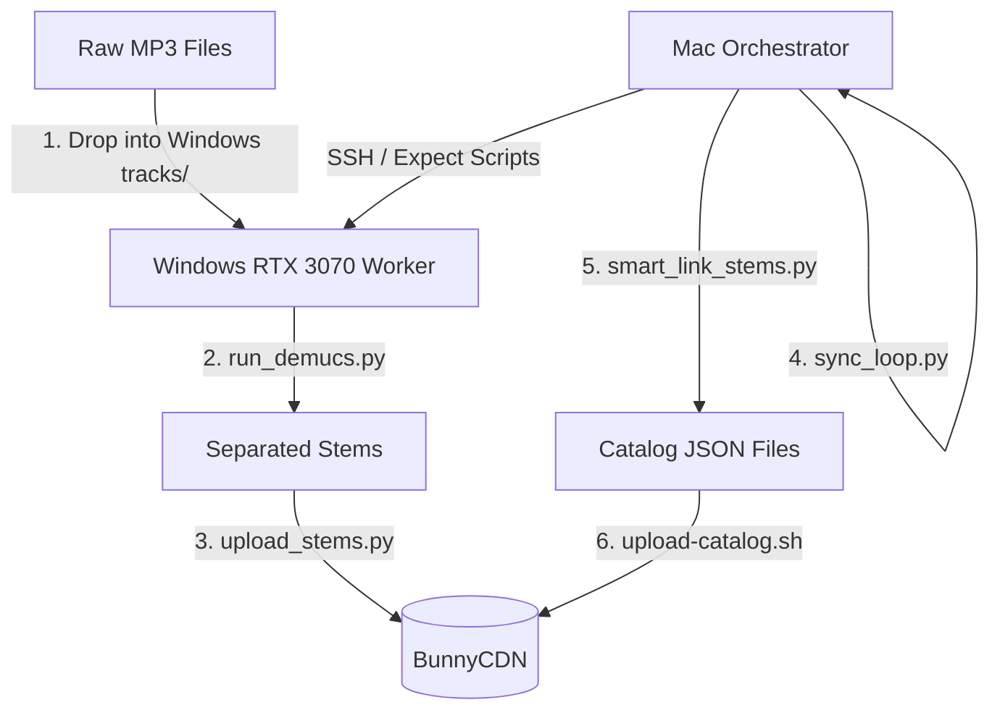

# Stems and Metadata Pipeline Guide

This guide consolidates all custom scripting tools created to manage the Zingy song catalog, handle remote GPU-accelerated stem separation, scrape track details, and publish updates to BunnyCDN.

All utility scripts are located in this directory: [/Users/dime/Developer/scrappadata/](file:///Users/dime/Developer/scrappadata/)

---

## Tooling Ecosystem Map



---

## 1. Remote Demucs GPU Separation Pipeline

When processing raw tracks into stems, the system utilizes a high-performance Windows PC to run GPU separations (RTX 3070) and upload files to the CDN, while your Mac acts as the orchestrator.

### Host Roles & Paths
*   **Mac Orchestrator**: Runs Expect scripts to control Windows via SSH.
*   **Windows Worker (`192.168.1.64`)**: Performs the heavy computational work.
    *   **Root Working Directory**: `C:\Users\Dimé\Desktop\DIME_STEM_PIPELINE\`
    *   **Virtual Env Python**: `C:\Users\Dimé\demucs_relay\venv\Scripts\python.exe`
    *   **Stems Output Folder**: `C:\Users\Dimé\Desktop\DIME_STEM_PIPELINE\tracks\separated\htdemucs_ft\`

### Orchestration Script Map (Mac Side)
*   **[sync_loop.py](file:///Users/dime/Developer/scrappadata/sync_loop.py)**: Coordinates the entire process. It loops every 45 seconds, monitors separation status on the Windows GPU, runs the remote CDN uploader, pulls completed track lists, and links them back to your local catalog.
*   **[run_uploader_win.exp](file:///Users/dime/Developer/scrappadata/run_uploader_win.exp)**: Connects to the Windows machine via SSH/SCP, copies the uploader python script, and runs it on the GPU PC.
*   **[get_all_separated_tracks.exp](file:///Users/dime/Developer/scrappadata/get_all_separated_tracks.exp)**: Runs a PowerShell command remotely to list all folder names in the separated directory and saves the list locally as `separated_raw.txt`.
*   **[generate_stems_list.py](file:///Users/dime/Developer/scrappadata/generate_stems_list.py)**: Compiles `separated_raw.txt` into a clean checklist at `/Users/dime/Desktop/separated_tracks_list.md`.
*   **[smart_link_stems.py](file:///Users/dime/Developer/scrappadata/smart_link_stems.py)**: Matches completed folders to local song JSON metadata records (matching titles and artists robustly), adds the new CDN stem URLs to the JSON file, and recompiles the index.

### Separation & Upload Scripts (Windows Side)
*   **run_demucs.py** (Run on remote PC): Scans for MP3 files under `tracks/`, ignores already-completed files, splits remaining tracks using CUDA-accelerated `htdemucs_ft`, and places them in `separated/`.
*   **upload_stems.py** (Run on remote PC): Multi-threaded uploader (12 workers) that uploads files to BunnyCDN's `videobb` storage zone. Remembers uploads locally in `uploaded_cache.json` to skip redundant transfers.

### How to Run it:
1. Drop raw `.mp3` tracks into `C:\Users\Dimé\Desktop\DIME_STEM_PIPELINE\tracks\` on the Windows PC.
2. Launch the demucs runner on the Windows PC to split the files.
3. On your Mac, start the synchronization loop:
   ```bash
   python3 /Users/dime/Developer/scrappadata/sync_loop.py
   ```

---

## 2. Metadata Scrapers (iTunes + Audio Analysis & Genius)

To enrich raw tracks with cover art, release details, BPM, key, and verified producer metadata, use the following local Python scripts.

### A. iTunes Metadata & Audio Analyzer
*   **File**: [metadata_scraper.py](file:///Users/dime/Developer/scrappadata/metadata_scraper.py)
*   **Functionality**:
    *   Queries the **iTunes Search API** to fetch high-res cover art (upscaling default thumbnails to `1000x1000bb`).
    *   Uses **`librosa`** to inspect the local MP3 file:
        *   Extracts duration.
        *   Estimates BPM.
        *   Runs correlation analysis with Krumhansl-Schmuckler profiles to guess musical key (e.g. "D Major").
    *   **Output**: Generates `metadata_cards.json` and `metadata_records.json`.

### B. Genius API Producer Scraper
*   **File**: [scrape_producers.py](file:///Users/dime/Developer/scrappadata/scrape_producers.py)
*   **Functionality**:
    *   Imports a Spotify exported CSV (`Liked_Songs.csv`).
    *   Queries **Genius Search API** to locate a song's Genius ID, then queries the Genius Song API to extract verified `producer_artists`.
    *   Utilizes a local cache file (`producer_cache.json`) to speed up runs and avoid API rate limits.
    *   **Output**: Dynamically builds a verified markdown catalog audit file at `/Users/dime/Desktop/liked_songs_metadata_audit.md`.

---

## 3. Catalog Publishing (BunnyCDN)

Once stems are uploaded and metadata JSONs are mapped, publish the new catalog definition to the CDN so the iOS app picks up changes.

### Folder Structure
Local files live in: `App/ZingyApp/Resources/musicdata/`
*   `music-index.json` — Song list overview (BPM, key, artist, title, artwork).
*   `release-formats.json` — Album/Single format labels.
*   `songs/NNNN.json` — Stems and production metadata detail file (lazy loaded).

### Commands
Execute the sync script from the project root:
```bash
# Preview what will upload
./scripts/upload-catalog.sh --dry-run

# Run full catalog sync
./scripts/upload-catalog.sh

# Upload only the song index
./scripts/upload-catalog.sh --only music-index.json
```
*Note: Make sure your `scripts/.env` file has the correct `BUNNY_STORAGE_PASSWORD` set.*
